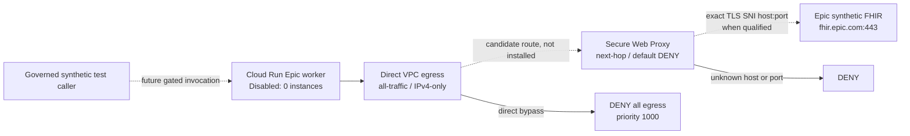

# CI-EXT-07G — Controlled Epic HTTPS egress gateway (architecture decision record)

**Status:** DESIGN ONLY; **no Cloud resources, firewall/route changes, credentials, scaling, FHIR requests or imports authorized by this document**.
**Date:** 2026-11-01
**Owner:** Helixis Platform & Security Engineering
**Predecessor:** CI-EXT-07F sealed worker, change `HELIXIS-EPIC-20261101-001`
**Policy contract:** `config/ci-ext07g-egress-design.json`
**Environment:** synthetic `studio-1130431360-48a05`, `us-central1` only.

## 1. Decision and non-goals

The candidate **managed** gateway is Google Cloud Secure Web Proxy (SWP) with
`NEXT_HOP_ROUTING_MODE`, no TLS decryption, and an exact SNI destination
allowlist for `fhir.epic.com:443`. This is a **conditional architecture
candidate**, not an approved deployment. It is contingent on proving that
Cloud Run Direct VPC egress, policy/route evaluation, and VPC firewall rules
*cannot allow direct bypass if a next-hop route is removed or altered*.

Crucial provider constraint: Google states that **SWP explicit proxy mode
without TLS inspection cannot perform reliable hostname filtering for
encrypted HTTPS**. It is therefore **not** an acceptable alternative if the
only control is `host() == "fhir.epic.com"` without inspection. Next-hop
mode documents SNI matching without TLS interception. SNI matching itself
is not path-level authorization; the application must validate every
destination path, host, method and redirect independently.

Do **not** create a priority-900 `ALLOW 0.0.0.0/0` firewall rule to make
SWP tests pass. In a routing failure this could become an unrestricted
outbound path. The existing priority-1000 network-wide IPv4 deny remains in
force. If next-hop routing cannot function *and* prove fail-closed behavior
without a dangerous override, **reject this design** and escalate to a
separately reviewed explicit proxy with TLS inspection or a tightly scoped
gateway service; do not weaken the network controls.

Non-goals: Epic production connectivity, patient import, gateway or service
activation, Secret Manager access, TLS interception, OAuth JWT signing,
FHIR write operations, clinical AI execution and clinical-data logging.

## 2. Verified starting boundary (CI-EXT-07F)

- Service `helixis-epic-sealed-worker`, revision
  `helixis-epic-sealed-worker-00001-ccv`, immutable container digest
  `sha256:2d17283162720114d8f6721e1bc0f94d0bac8f6755086061858fbbedf414dfd1`.
- Runtime service account `helixis-epic-staging-runtime@studio-1130431360-48a05.iam.gserviceaccount.com`.
- Cloud Run gen2, 1 vCPU / 512Mi; manual scaling=0, default URL disabled,
  internal ingress; no traffic tags or public invoker grants recorded.
  First revision has 100% routing *allocation*, not running instances.
- Direct VPC egress `all-traffic`, VPC `helixis-epic-egress`,
  subnet `helixis-epic-us-central1`, tag `helixis-epic-worker`.
- Effective network firewall: `helixis-epic-deny-egress`, EGRESS DENY
  all protocols to `0.0.0.0/0`, priority 1000, enabled, no target tags;
  no higher-precedence ALLOW shown by the operator's inspection.
- No secret volume/env references. Policy Troubleshooter: effective Epic
  secret `secretmanager.versions.access` = `CANNOT_ACCESS`; allow
  `NOT_GRANTED`, deny state unknown. Review on activation.
- Environment: `HELIXIS_EPIC_WORKER_MODE=SEALED`,
  `GHIMS_RUNTIME_MODE=STAGING`, FHIR integration/auth/import disabled.
- No live network test from this disabled revision has been qualified.
  The CI-EXT-07E job's `PASS_NO_TCP_CONNECTION` was for a *different*
  workload and cannot prove the cause or policy of this deployed service.

## 3. Data-plane and control-plane architecture

Control plane: a dedicated gateway security policy, independent security
review, immutable policy artifact, policy/config drift monitoring,
auditable change ticket, and separate infrastructure-operator identity.
Do not attach a broader policy that allows unrelated services or tenants.
A gateway may automatically provision Cloud NAT in the same region and VPC;
include that resource and its lifecycle in cost, route and IAM reviews.

Data plane after future approval: application resolves no arbitrary
destination, refuses IPv4 literal hosts, user-controlled URLs, redirects,
unknown ports, unknown methods, and non-sandbox FHIR base paths; then uses
standard TLS verification to the Epic origin. No local trust-all flags,
certificate-validation bypass, interception CA, or `NODE_TLS_REJECT_UNAUTHORIZED=0`.
TCP, HTTPS and QUIC/HTTP3 alternate paths must be denied unless explicitly
qualified. Treat SNI mismatch, ECH, missing SNI, DNS rebinding, IPv6,
proxy failure and route drift as deny conditions.

The token endpoint and sandbox FHIR base both use the **same exact**
approved `fhir.epic.com` host. Without TLS inspection, gateway matching
does **not** restrict URL paths or HTTP methods; that contract must be
enforced in a server-side HTTP client and tested against SSRF and open
redirects. Do not let arbitrary external-HIS URLs reuse this Epic gateway.
The first clinical/data operation, if ever approved, is a separate
synthetic **read-only** FHIR qualification; signing and import remain
disabled in CI-EXT-07G.

## 4. Alternatives and explicit rejection criteria

| Candidate | Benefit | Blocker / decision |
| --- | --- | --- |
| SWP next hop + SNI | Managed, no TLS decryption, host check and central logs | **Preferred conditional candidate**. Must prove route/firewall behavior from Cloud Run; don't allow all Internet in VPC to fix it |
| SWP explicit CONNECT, TLS inspection off | Egress firewall could allow only proxy private IP | **Rejected:** docs say HTTPS hostname matching isn't available without inspection |
| SWP explicit, TLS inspection on | Can allow proxy IP only at VPC firewall and inspect host/path | **Alternative only after separate privacy/security approval:** middlebox sees OAuth bearer tokens and synthetic clinical content; CA and audit duties, costs |
| Self-managed Envoy/egress service | Precise application-level hostname/route enforcement and low idle-cost potential | Requires secure updates, sandboxed runtime, DNS pinning, SNI/Host authority checks, capacity/HA, code/incident review |
| Raw Cloud NAT or broad internet firewall | Easy connectivity | **Rejected:** no reliable per-host egress boundary, bypasses deny-by-default |
| Static IP addresses for `fhir.epic.com` | Simple firewall policy | **Rejected:** Epic may change addresses; DNS/IP mismatch, supply chain and operational fragility |

**Go/no-go rule:** If validated effective routing requires a
source-tag `ALLOW 0.0.0.0/0` or other bypass-capable exception, return
**NO-GO**; do not reuse the original staged VPC for a broad test.

## 5. Qualifications required before provisioning

1. **Cost signoff.** Google SWP Standard list pricing currently
   `$1.25/hour/gateway + $0.0193/GiB`: ~`$912.50` for a 730-hour
   gateway-month before Cloud NAT, network, logs, Cloud Run, and any
   inspection/Certificate Authority Service charges. Obtain explicit
   budget and teardown plan; never create an always-on service by default.
2. **Feature support.** Independently validate SWP next-hop + Cloud Run
   Direct VPC egress integration in same region and VPC, supported source
   tag/route scope, endpoint modes, TLS SNI matching, and policy source
   identity for this runtime (do not assume VM SA matching works for Cloud Run).
3. **Route and firewall proof in an isolated disposable VPC**, not by
   modifying `helixis-epic-egress`: show the exact effective rule and next-hop
   before/after route removal, under priority conflicts and gateway outage.
   Route failure must not fall back to an internet default gateway.
4. **Negative destination matrix (mandatory):**
   `evil.example:443`, subdomains of `fhir.epic.com`, wrong ports,
   wrong SNI/CONNECT authority, no SNI/ECH, literal public IP, IPv6,
   URL redirect to another domain, direct socket to public IP,
   alternate DNS, route removal, firewall override, gateway outage,
   NAT change, QUIC/UDP 443, malformed TLS, and expired/revoked certs.
   All blocked; preserve evidence from the *actual source workload*
   before changing its scaling state for normal operation.
5. **Positive synthetic path, only after separate approval:** allow
   `fhir.epic.com:443` and validate certificate chain and HTTP
   connectivity with non-clinical test request; no OAuth secret or FHIR
   data until a later explicitly reviewed gate.
6. **Authorization and privacy:** no inbound public invoker; token/signing
   secrets remain inaccessible. Logs may contain action, policy ID,
   sanitized host:port, correlation ID and outcome, but never full URLs
   with patient identifiers, Authorization headers, token assertions,
   access tokens, JSON bodies or FHIR responses.
7. **Audit/rollback:** write signed policy version, before/after effective
   firewall and route inventories, denial tests, resource inventory,
   operator, reviewer and approved change ID to append-only evidence.
   If any gate fails, restore deny-only configuration and retain
   `manualInstanceCount=0`; independently verify no residual NAT,
   policy, IAM or gateway resource.
8. **Drift guard:** alarm on service scaling > 0, default URL activation,
   invoker policy changes, enabled imports, secret grants, new egress
   ALLOW rule, proxy rule broadening, route changes, SNI policy
   weakening and IAM anomalies.

## 6. Implementation sequencing and owners

| Phase | Deliverable | Cloud mutations |
| --- | --- | --- |
| 07G-A (this PR) | ADR, fail-closed JSON policy contract, static safety tests and CI | **None** |
| 07G-B | Disposable VPC lab specification, cost/teardown approval, platform support matrix | None until separate approval |
| 07G-C | Isolated cost-capped gateway, route and deny tests; log non-sensitive evidence | Explicit separate infrastructure change |
| 07G-D | Review/test gateway routing from a dedicated synthetic probe with **no Epic secret** | Explicit separate network and probe change |
| 07G-E | Independently approve any worker scaling and future source code; verify negative egress from worker | Separate release |
| Future 07H | Sign/rotate Epic sandbox assertion, grant single-secret access; read-only synthetic FHIR validation | Separate clinical + security release |

07F's sealed image has **no outbound HTTP client**. Do not claim its
existing revision can run positive FHIR tests without another reviewed code
image. No clinician-facing data is imported in CI-EXT-07G.

## 7. Operational failure and abuse handling

- **Gateway unavailable / DNS failure / TLS mismatch:** fail closed,
  bounded retries with jitter for safe idempotent GET only, circuit breaker,
  no direct fallback, fail workflow as deferred; no synthetic clinical
  data silently accepted as fresh.
- **Proxy returns 403:** treat as policy denial, do not retry with
  alternate domains, ports, IP literals or credentials.
- **401/403 from Epic:** keep separate from proxy denial. Do not fetch or
  rotate key inside gateway; report sanitized provider status.
- **429/5xx:** bounded retry only on proven-safe reads and after
  `Retry-After` handling; no unbounded queue or writes.
- **Replay, tenant crossing, stale responses:** immutable event provenance
  and idempotent synthetic request IDs, tenant/site-bound correlation,
  non-PHI observability; no patient projections until separate clinical gate.
- **Leakage risks:** explicit redaction for query strings, response bodies,
  bearer tokens and signed JWT assertions; no decrypted content logging.
  Re-evaluate privacy obligations before adding TLS inspection.
- **Budget overrun / infra orphan:** set cost alerts (not a hard spending
  cap); have an operator-approved teardown with observed zero resources.

## 8. Evidence, risk register and approval checklist

| Risk | Severity | Release gate |
| --- | --- | --- |
| SWP next-hop route blocked by VPC deny | High | Network lab support/proof before any allow change |
| Direct bypass on route removal | Critical | Negative test; reject design if fallback path exists |
| TLS SNI bypass, ECH, host mismatch | Critical | Negative test; fail closed |
| Proxy auth identity unsupported for Cloud Run | High | Source identity or IP scope proven, no wider access |
| Middlebox sees bearer token or FHIR payload | High | No TLS inspection unless explicit privacy approval |
| SWP + NAT idle recurring cost | High | Cost cap, timebox and resource teardown |
| Changes leak across tenants/services | Critical | Dedicated VPC, tag, SA, route isolation tests |
| Unintended clinical imports | Critical | Import disabled in CLI, server, IAM and data layer |

**Sign-off required:** Platform/SRE, Security, Integration/Epic,
Clinical Governance (before any patient-like payload), and Finance for
gateway-hour expenditure. PR green is not an infrastructure approval.
Any violation is **NO-GO** and the sealed service remains disabled.

## 9. Sources (Google Cloud official)

- [Cloud Run Direct VPC egress](https://docs.cloud.google.com/run/docs/configuring/vpc-direct-vpc)
- [SWP overview, support, deployment modes](https://docs.cloud.google.com/secure-web-proxy/docs/overview)
- [SWP SNI vs explicit proxy hostname matching](https://docs.cloud.google.com/secure-web-proxy/docs/configure-rules)
- [SWP next-hop mode and static/policy-based routing](https://docs.cloud.google.com/secure-web-proxy/docs/deploy-next-hop)
- [SWP rule and policy types](https://docs.cloud.google.com/secure-web-proxy/docs/policies-and-rules-overview)
- [SWP automatically provisioned Cloud NAT](https://docs.cloud.google.com/secure-web-proxy/docs/use-cloud-nat-for-swp)
- [SWP published USD pricing](https://cloud.google.com/secure-web-proxy/pricing)
